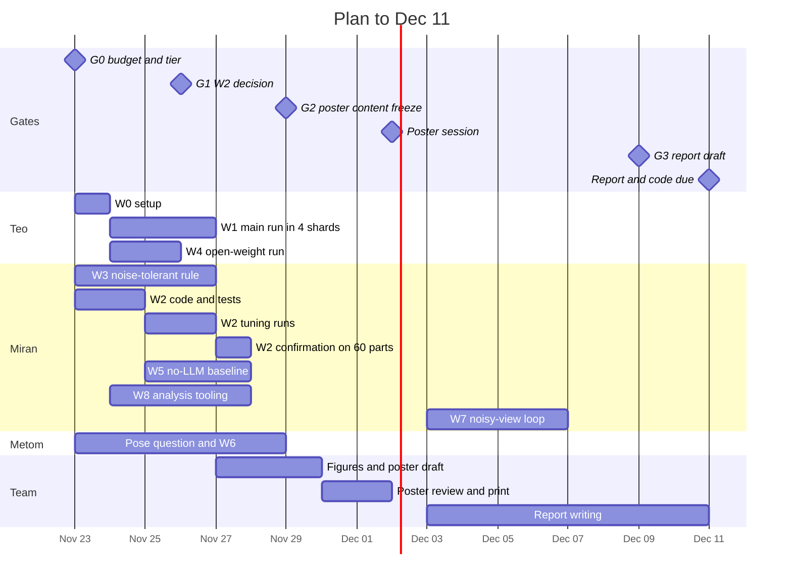

# Plan to the poster (Dec 2) and report (Dec 11)

Last updated 2026-11-23. Poster session **Wed Dec 2**; report and documented code **Fri Dec 11**.

This file is the team's shared plan, for us and for our coding agents. Humans: read §1–§4.
Agents: pick a workstream from the status board (§4), follow its spec in §5, and update the
board in the same PR as the work.

## 1. Summary

- **The proposal's main experiment has not run yet.** It is the Stage 1 comparison of VLM
  review vs. geometric checks on the 60 held-out parts, and it is the poster's headline. W1
  starts first.
- **Stage 2 is half done.** The checker study is in PR #9 (`docs/STAGE2.md`). The promised
  noise-tolerant rule (W3) can be built offline for free.
- **New: feedback and patience for the geo loop (W2).** Rejected edits currently vanish without
  a trace, and worse-before-better fixes get blocked. We test an attempt history and a patience
  rule on 18 tuning parts, with a decision rule fixed in advance.
- **Cheap extras that answer likely questions at the poster:** an open-weight agent (W4,
  promised in the proposal), a baseline with no LLM (W5), and how real-photo noise compares
  with our synthetic noise (W6).
- **Gemini spend:** about $75 at minimum (W1), $120–140 recommended (W1 + W2), $160–180 for
  everything (§6). Everything else is free.
- **Poster draft:** `poster/` (LaTeX, builds to `poster/poster.pdf`). Grey boxes are
  placeholders, each naming the workstream that fills it.

## 2. Rules for humans and agents

1. **Paid calls.** Commands marked **[PAID]** call Gemini on the team's GCP budget. Agents never
   run one unless a teammate said so in that session and the chosen tier (§6) covers it. Test
   every new command with `--backend echo` first. It is a free fake agent.
2. **Tuning discipline.** Choose prompts, flags and thresholds only on tuning parts:
   `data/fusion360/tuning.txt` (9 parts) or `data/fusion360/tuning18.txt` (18 parts, which
   include those 9). Run each final method on the 60 Stage 1 parts (`data/fusion360/stage1.txt`)
   once. The pilot parts `127274_6484a80b_0000`, `135654_34a24e52_0000` and
   `22011_0832eefe_0013` count as seen during development.
3. **Branches and PRs.** Work on a branch and open a PR; never push to `main`. Changes to
   `refine.py`, `vlm.py` or `geo_check.py` need Teo's review.
4. **Defaults stay put until a decision gate.** New behaviour goes behind a flag whose default
   is today's behaviour, until its decision rule (below) says to switch.
5. **Share results in git.** `runs/` is git-ignored. After a run, copy its `README.md`,
   `results.md`, `results/summary.json` and `results/figures/` to `docs/results/<run-name>/`
   and commit them.
6. **Keep the board current.** Update §4 in the same PR as the work: status, a link to
   results, and a one-line headline.
7. **Tests.** Run `uv run pytest -q` before a PR. Four tests in `tests/test_illegal_shapes.py`
   also fail on `main` on macOS (the exception name differs); ignore those.

## 3. Where we stand against the proposal

| Promised (proposal, Oct 16) | Status |
|---|---|
| Working refinement pipeline | Done (Teo) |
| **Stage 1: VLM visual review vs. forward-rendering checks on held-out parts** (main goal) | Not run; only 3-part pilots → **W1** |
| Metrics: 3D IoU, surface error, good/harmful edits kept, runtime and cost | Code computes all of them (`eval3d.py`, `summarize_runs.py`); needs W1 |
| (ii) Proprietary vs. open-weight agent | Not run. `--backend ollama` (Gemma 4 12B) is wired in → **W4** |
| (iii) View weights from mask/depth agreement | Done; tested in Stage 2 |
| Stage 2: controlled mask/depth corruptions | Done: checker study, 56 parts × 24 conditions (PR #9) |
| **Stage 2: noise-tolerant acceptance rule** (Week 4) | Not built → **W3** |
| Masks/depth from SAM 3 / VGGT ("if time permits") | Exist for RealCAD photos (Metom), not connected → **W6** |

**The story for the poster and report.** Image-to-CAD refinement is an inverse problem. The
CadQuery program is the unknown and rendering from calibrated cameras is the forward model.
Silhouettes and depth are the measurements. Stage 1 asks whether checking the forward model
against the measurements judges edits better than a VLM looking at pictures. Stage 2 asks
what happens when the measurements are wrong, as they are with real photos. GATOR (Appendix
D.7) names both as open problems, and we address both.

**The Stage 2 insight to lead with.** A mask that is too fat everywhere looks exactly like a
slightly fatter object seen from every camera. The views still agree with each other, so no
consistency check can catch it, including our view weights. Only a model of the noise can.
That is why 6 px dilation is the checker's worst case: 70% right decisions and 23% of harmful
edits kept, against 93% and 4% on clean views. It is what W3 targets.

## 4. Status board

| ID | Workstream | Owner (proposed) | Needs | Gemini cost | Due | Status |
|---|---|---|---|---|---|---|
| W0 | Setup: budget, pilot logs, PR #9, tuning targets | Teo, Miran | n/a | $0 | Nov 24 | In progress: 18-part tuning split committed |
| W1 | Main Stage 1 comparison | Teo | W0 budget | ~$75 | Nov 26 | Not started |
| W2 | Feedback + patience for the geo loop | Miran (Teo reviews) | W0 | ~$26, then $16–44 | Nov 27 | Not started |
| W3 | Noise-tolerant acceptance rule | Miran | PR #9 | $0 | Nov 26 | Not started |
| W4 | Open-weight agent | Teo or Metom | W0 targets | $0 | Nov 26 | Not started |
| W5 | Baseline with no LLM | Miran | PR #9 | $0 | Nov 27 | Not started |
| W6 | Real-photo noise check | Metom | pose answer (§11) | $0 | Nov 28 | Not started |
| W7 | Agent loop on noisy views | Miran | W3 | ~$15 | Dec 6 | Not started |
| W8 | Analysis tooling: shard merge, paired CIs | Miran | W1 shards | $0 | Nov 27 | Not started |
| P | Poster | All | W1–W6 | n/a | Dec 2 | Draft in `poster/` |
| R | Report + documented code | All | all | n/a | Dec 11 | Not started |

## 5. Workstreams

### W0. Setup ($0)

- [ ] **Teo:** write the remaining GCP budget and the chosen tier (§6) into this file.
- [ ] **Teo:** copy the pilot runs' summaries to `docs/results/pilots/`: each run's
      `README.md`, `results.md` and `parts/*/scores.md`. Add the mean prompt and output
      tokens per call from `results/summary.json`. These replace the guesses in §6.
- [ ] **Teo:** review and merge PR #9 (`corrupt.py`, `checker_eval.py`, `docs/STAGE2.md`).
      W3, W5 and W7 build on it.
- [x] **Miran:** `data/fusion360/tuning18.txt` holds 18 tuning parts: the original 9 plus 9 more,
      with the same strata and seed and none from Stage 1. Reproduce with:
      ```sh
      uv run python -c "import argparse, cadrille_init as c; ex=set((c.SPLITS/'stage1.txt').read_text().split()); c.split(argparse.Namespace(per_bin=6), out_name='tuning18', exclude=ex, seed=c.SEED+1)"
      ```
- [ ] Each machine that runs W2, W3 or W4 builds the tuning targets and starting programs. This
      is free and takes a few minutes:
      ```sh
      uv run python data/fusion360_targets.py --split data/fusion360/tuning18.txt --out data/generated/targets/fusion360_tuning18
      uv run python cadrille_init.py convert --tag rl --targets data/generated/targets/fusion360_tuning18 --out data/generated/init/cadrille_rl_tuning18
      ```

**Done when** the tier is recorded, the pilot summaries are committed, PR #9 is merged, and
the tuning targets exist where they are needed.

### W1. Main Stage 1 comparison [PAID, ~$75]

**Question:** do forward-rendering checks guide and judge edits better than VLM visual review?
This is the proposal's main goal.

**Settings:**
- Arms `premise`, `vlm`, `geo` and `hybrid` on the 60 Stage 1 parts, 4 rounds each, starting
  from cadrille's RL programs.
- `--shadow-judge` makes Gemini's judge also vote on edits in arms that don't use it. The
  geometric check already logs a decision in every arm. Together they give judge vs. checker
  accuracy on the exact same edits.
- The `oracle` arm (+$15) is optional. It shows the upper bound of a perfect gate.

1. Free dry run on two parts:
   ```sh
   uv run python refine.py $(head -2 data/fusion360/stage1.txt | sed 's|^|data/generated/targets/fusion360/|') \
       --init data/generated/init/cadrille_rl --arm premise,vlm,geo,hybrid --rounds 4 --shadow-judge \
       --backend echo --name stage1_echo
   ```
2. **[PAID]** Run in 4 shards of 15 parts. `refine.py` makes one model call at a time, so a
   single process would take more than a day. Each shard runs all arms on its own parts, so if
   time runs out, the finished parts are still a fair comparison.
   ```sh
   mkdir -p runs
   for k in 0 1 2 3; do
     uv run python refine.py $(sed 's|^|data/generated/targets/fusion360/|' data/fusion360/stage1.txt | awk -v k=$k 'NR%4==k') \
         --init data/generated/init/cadrille_rl --arm premise,vlm,geo,hybrid --rounds 4 --shadow-judge \
         --name stage1_s$k > runs/stage1_s$k.stdout 2>&1 &
   done
   ```
3. Check spend after about 10 parts in total. Read the tokens in each shard's
   `results/summary.json` and project the total. Stop and re-plan if the projection is above
   1.3× the estimate. Also check how many replies hit the token cap and how many edits failed
   to build.
4. Merge the shards into one run folder and summarise it (W8 provides `merge_runs.py`).
   Copy the summaries to `docs/results/stage1/` and fill in the board.

**Report:** most of these come straight from `summarize_runs.py`; CIs come from W8.
- per arm: 3D IoU from start to final (median and mean) and Chamfer
- parts that got better or worse
- edits kept that helped, kept that harmed, dropped that would have helped, dropped that would
  have harmed
- checker vs. judge on the same edits: accuracy, harmful edits kept, agreement
- per-stratum gains (IoU bin × complexity) and change types (structural / dimensional /
  positional)
- invalid-edit rate, tokens, $ and minutes per part

**Done when** all 60 parts × 4 arms are finished (56 have a 3D IoU), the merged run is
summarised, `docs/results/stage1/` is committed and the board is updated.

### W2. Feedback and patience for the geo loop [PAID, ~$26 + $16–44]

**Problem:**
- After a rejected edit, the next round is a fresh session with the same program and pictures.
  The agent is not told it tried anything or why it failed, so it can repeat the same edit.
- Some good fixes make things worse for a round before they get better, and the gate blocks
  them.

**Changes in `refine.py`**, behind flags whose defaults keep today's loop:
1. **`--history`.** Each edit prompt gets a short text log of the earlier rounds, about 300
   tokens of text with no old images. The reason comes from `geo_accept`'s details (`gain`,
   `worst_view`, `worst_view_drop`), which today only go to the log:
   ```text
   Earlier attempts on this part (most recent last):
   round 1: [dimensional] "made the base 20% thicker" -> kept (geo score +0.012)
   round 2: [positional] "moved the hole 5 units left" -> rejected: front IoU 0.91 -> 0.84, extra material on the right
   round 3: [structural] "added a fillet on the top edge" -> rejected: no measurable change
   ```
2. **`--patience N`.**
   - The best program so far, by geo score, is the checkpoint. An edit that passes the gate
     against the checkpoint becomes the new checkpoint.
   - A worse edit may stay "on trial" for up to N rounds. If nothing beats the checkpoint by
     then, roll back to it and say so in the history.
   - The final answer is always the checkpoint.
   - `N=0` is today's loop. `N=-1` keeps every edit ("keep-all").
3. **New round outcomes** `kept_on_trial` and `rolled_back` in `log.jsonl`, `scores.md` and the
   round folder names (`report.py`, `_label_round`).
4. **Where the code goes.** The round loop is `refine_part` in `refine.py`, which keeps `cur` and
   `best_geo`. The prompt is built by `vlm.refine_prompt`, which gets a `history=` argument.
   Add echo tests in `tests/test_refine_echo.py` for the history text and for the rollback logic.

**Experiment [PAID]:** 18 tuning parts, 8 rounds, the same cadrille start for every arm. Results
are read at rounds 4, 6 and 8 from the same runs, because earlier rounds never depend on later
ones.

| Arm | Flags | Tests |
|---|---|---|
| geo | (none) | today's loop |
| geo again | (none), `--seed 1` | noise floor: same settings, new random draws |
| geo + history | `--history` | feedback alone |
| geo + history + patience | `--history --patience 2` | feedback + short detours |
| geo + history + keep-all (optional, +$7) | `--history --patience -1` | whether the gate is needed at all |

```sh
T=$(sed 's|^|data/generated/targets/fusion360_tuning18/|' data/fusion360/tuning18.txt)
I=data/generated/init/cadrille_rl_tuning18
uv run python refine.py $T --init $I --arm geo --rounds 8 --name w2_geo                      # [PAID]
uv run python refine.py $T --init $I --arm geo --rounds 8 --seed 1 --name w2_geo_again       # [PAID]
uv run python refine.py $T --init $I --arm geo --rounds 8 --history --name w2_hist           # [PAID]
uv run python refine.py $T --init $I --arm geo --rounds 8 --history --patience 2 --name w2_hist_p2  # [PAID]
```
The runs are independent, so they can run in parallel.

**Measured at rounds 4, 6 and 8:**
- final 3D IoU and the paired gain over geo, with a 95% CI
- repeat rate: edits that propose an earlier rejected change again (the same program, or the
  same number changed in the same direction)
- keep rate, trials and rollbacks
- the round at which the final answer was reached
- harmful edits kept and good edits dropped
- the gap between the geo-score pick and the true best state (`best_geo` vs. `best_any`)
- $ and minutes per part

**Decision rule** (fixed now, before any run):
- The winner is the arm and round count with the largest mean paired 3D IoU gain over geo at
  the same round count.
- It counts only if the gain is larger than the mean |geo − geo again| difference (the noise
  floor), and it does not raise the number of parts that end below their cadrille start.
- Report the 95% CI either way.
- Ties within the noise floor go to fewer rounds, then to the simpler arm.
- If no arm wins, keep geo as it is and report the negative result with the repeat-rate
  analysis.

**Confirm on the 60 Stage 1 parts [PAID, $16–44]:** run the winner once. In the W2 runs,
check whether plain geo still gained more than the noise floor between round 4 and the
winner's round count. If it did, also run plain geo for that many rounds. If not, W1's
4-round geo arm is the baseline.

**Scope:** history is tested on the geo arm only. That way W1's main claim (checker vs. VLM
review) has no memory confound. Say so in the report.

**Done when:**
- the flags are merged after Teo's review
- the W2 runs are summarised in `docs/results/w2/`
- the decision is written on the board
- the confirmation run is summarised

### W3. Noise-tolerant acceptance rule ($0)

**Problem** (`docs/STAGE2.md`):
- A 6 px dilated mask makes the checker keep 23% of harmful edits (4% on clean views), and the
  view weights cannot see it.
- A per-view depth-scale error makes the weights discount silhouettes that were perfect: 87%
  right decisions with weights vs. 93% without.

**Variants**, behind flags in `geo_check.py` / `compare.py` with defaults unchanged:
1. **Boundary band:** ignore pixels within k px of the target mask boundary in the silhouette
   IoU, for k ∈ {0, 1, 2, 3, 4, 6, 8}.
2. **Split weights:** a silhouette weight from mask-only consistency and a depth weight from
   depth consistency, each applied to its own term of `geo_score`.
3. **Stretch goal:** estimate a uniform boundary offset per view and remove it before scoring.

**Procedure:**
1. Build checker-study candidates for the 18 tuning parts and their noisy copies. This is free
   and runs on CPU:
   ```sh
   uv run python corrupt.py data/generated/targets/fusion360_tuning18 --split data/fusion360/tuning18.txt
   uv run python checker_eval.py data/generated/targets/fusion360_tuning18 \
       --init data/generated/init/cadrille_rl_tuning18 --split data/fusion360/tuning18.txt --edits 8 --name w3_tuning
   ```
2. Pick the variant and k with the best mean right-decision rate over the 24 conditions, with
   at most 1 point lost on clean views.
3. Report it once on the 56 Stage 1 parts, which reuses the cached candidates of the Stage 2
   run.

**Output:** the Stage 2 accuracy chart with the current rule vs. the new one, plus a table.
Update `docs/STAGE2.md`.

**Done when** the variant is chosen on tuning parts, the 56-part results are in
`docs/STAGE2.md`, and the flag is merged with its default unchanged.

### W4. Open-weight agent ($0)

```sh
uv run python refine.py $(sed 's|^|data/generated/targets/fusion360_tuning18/|' data/fusion360/tuning.txt) \
    --init data/generated/init/cadrille_rl_tuning18 --arm geo --rounds 4 --backend ollama --name w4_gemma
```
- Needs `ollama` with `gemma4:12b` pulled. On a laptop, expect minutes per call; a GPU machine
  is faster.
- Compare with W2's `w2_geo` on the same 9 parts at round 4: build success, repairs used, kept
  edits, 3D IoU gain and seconds per round.
- An open model whose edits mostly fail to build is still a result: it explains why Gemini is
  the main agent.

**Done when** the run is summarised in `docs/results/w4/` and the comparison is on the board.

### W5. Baseline with no LLM ($0)

**Question:** if the checker is a good objective, do we need an LLM at all? A computational
imaging audience will ask.

**Method:** search over the program's numbers using only the checker, with no ground truth.
- Try each number ×0.9 and ×1.1, or a shift if it is 0. Keep a change when `geo_accept` passes.
- Repeat with ×0.95 / ×1.05.
- Stop after 150 builds per part, or when nothing improves.
- Second row: start from W1's final geo program, so the agent fixes structure and the search
  fits the numbers.

**Implementation:** a new `optimize_numbers.py` that reuses `checker_eval.perturb`, the candidate
building in `checker_eval.py`, and `geo_check.geo_accept`. It calls `eval3d` only for the final
score.

**Cost:** about 3–7 s per build on a laptop (a `refine.py` round measured ~6.6 s including 3D
scoring). 60 parts × 150 builds is about 12 CPU-hours, so run it overnight with threads.

**Report:**
- 3D IoU from start to final, next to the W1 arms
- W1's gains split by change type (structural / dimensional / positional)

**Done when** the results are in `docs/results/w5/` and on the board.

### W6. Real-photo noise check ($0)

**Needs:** an answer to whether the camera poses in `data/realcad/test50` are in the GT mesh's
frame.

**Steps:**
1. For RealCAD parts with ground truth, render the true silhouettes and depth at the estimated
   cameras.
2. Compare them with the SAM 3 masks and VGGT depth: mask IoU, signed mean boundary offset (px;
   + = too fat), hole and blob area, depth scale error and residual noise.
3. Place each part on the Stage 2 curves at the nearest synthetic kind and level.

**If the poses are not in the GT frame:** make a qualitative panel (photo, SAM 3 mask, cadrille
render) plus the statistics that need no ground truth.

**Done when** a table and figure are in `docs/results/w6/` and the poster panel is filled.

### W7. Agent loop on noisy views [PAID, ~$15]

- Geo arm, 4 rounds, on 20 of the 60 Stage 1 parts, stratified 7/7/6 by IoU bin. Commit the list
  as `data/fusion360/stage1_sub20.txt`, drawn with a fixed seed.
- Two conditions, `dilate_L3` and `bad_view_L3`, each with the current rule and with W3's rule:
  4 runs.
- Noisy targets keep their part names, so `--init data/generated/init/cadrille_rl` applies
  unchanged (see `docs/STAGE2.md` §4).
- This shows the checker's failure and the fix end to end. It is for the report, after the
  poster.

### W8. Analysis tooling ($0)

1. **`merge_runs.py`:** combine shard folders into one run folder. `summarize_runs.py` reads
   `parts/*/*/log.jsonl` and `result.json`, and `report.py` reads `config.json` and `parts/`.
   Test it on two echo shards before W1 finishes.
2. **`compare_runs.py`:**
   - per-arm paired gains against a baseline arm at a chosen round
   - 95% bootstrap CI over parts (10,000 resamples)
   - parts that got better or worse
   - repeat rate for W2
3. Poster figures with the arm colours from `figures.py`, at poster font sizes.

## 6. Budget

**Price:** Gemini 3.8 Flash on Vertex costs $0.75 per 1M input tokens and $3.75 per 1M output
tokens. Thinking counts as output. This is an introductory rate through Dec 31, 2026. Confirm it
in the GCP console before W1: the pricing page did not render for our fetcher, so these numbers
come from Google's pricing page via search and from a third-party calculator (Sources).

**Per call** (estimates until W0's pilot token counts replace them; Gemini 3 bills an image at
1,120 tokens by default):

| Call | Input tokens | Output tokens | Cost |
|---|---|---|---|
| Edit, geo (5 images) | ~7k | ~8k | ~$0.035 |
| Edit, premise / vlm (2 images) | ~3.5k | ~8k | ~$0.033 |
| Judge (3 images) | ~3.6k | ~4k | ~$0.018 |
| Question answers / feedback | ~1–2k | ~3–4k | ~$0.012–0.016 |

Build-error repairs add about 30% more edit calls. Output is about 85% of the cost, so how long
Gemini thinks is the big unknown.

| Tier | Contents | Typical | If replies think 2× longer |
|---|---|---|---|
| A, minimum | W1: 4 arms × 60 parts × 4 rounds + shadow judge | ~$75 | ~$140 |
| B, recommended | A + W2 (4 arms × 18 parts × 8 rounds) + W2 confirmation | ~$120–140 | ~$220–260 |
| C, full | B + oracle arm + W7 + keep-all arm | ~$160–180 | ~$290–330 |

W3–W6 and W8 are free in every tier.

**Cost controls:**
- W0 replaces the guesses with real token counts; re-estimate before W1.
- Check spend after about 10 parts of W1; stop and re-plan above 1.3× the estimate.
- Levers if money is tight:
  - drop hybrid (−$22; the pilots already suggest it does not help)
  - skip oracle
  - lower the thinking level for judge and question calls. This needs a small code change and
    must be decided before W1, because it applies to all arms.

## 7. Timeline



| Gate | Date | What is decided |
|---|---|---|
| G0 | Nov 23 | Budget and tier |
| G1 | Nov 26 | W2 winner, by the rule in W2 |
| G2 | Nov 29 | Poster content freeze: what is finished goes on the poster |
| G3 | Dec 9 | Full report draft for team review |

## 8. Keeping results honest

- **Paired comparisons by part**, with a 95% bootstrap CI over parts on every mean gain.
- **The W2 noise floor** (geo vs. geo again) shows how big a difference must be to mean
  anything. Quote it next to W1's results too.
- **Tuning discipline** (rule 2), with decision rules written before the runs (W2, W3).
- **Every promised metric:** 3D IoU (on the 56 parts with watertight ground truth), Chamfer (all
  60), beneficial and harmful edits kept, and $ and minutes per part.
- **Negative results with a reason:** hybrid in the pilots, view weights on depth-scale errors,
  and anything W2 does not improve.
- **Deviations from the proposal, explained:**
  - Fusion360 parts from cadrille's test split instead of procedural or DeepCAD shapes.
  - Gemini 3.8 Flash as the main agent, with an open model as the comparison.
  - cadrille as the starting program, which was the proposal's planned fallback.

## 9. Poster and report

**Poster** (`poster/poster.tex`, A0 landscape; confirm the required size): panels in order.
1. Question and method: the loop as forward model → compare with measurements → keep or
   revert, and GATOR's two open problems.
2. **Stage 1 (W1):** 3D IoU gain per arm with CIs, the checker vs. the Gemini judge on the same
   edits, and an example.
3. **Making the loop learn (W2):** 3D IoU vs. round with the noise band, and the repeat rate.
4. **Stage 2 (PR #9 + W3):** accuracy vs. corruption with the current and the noise-tolerant
   rule, and the fat-mask insight.
5. **Real photos (W6).**
6. Takeaways, with cost per part, the open model (W4) and the no-LLM baseline (W5).

**Report** (6 pages):

| Section | Pages |
|---|---|
| Introduction and related work | 1.25 |
| Method: forward model, checker, view weights, loop, history and patience | 1.25 |
| Stage 1 results (W1, W2, W4, W5) | 1.5 |
| Stage 2 results (checker study, W3, W6, W7) | 1.25 |
| Discussion and limitations | 0.5 |
| References | 0.25 |

## 10. Risks and fallbacks

| Risk | Fallback |
|---|---|
| W1 starts late or runs slowly | Shards. The poster uses the parts finished by Nov 29 (each shard covers all arms); the rest goes in the report |
| Budget below tier A | Drop hybrid and oracle; keep premise, vlm and geo |
| Replies hit the token cap | Watch the cut-off rate in the first 10 parts; thinking is already "medium" |
| W2 finds no gain | Report the negative result with the repeat-rate analysis |
| W3's rule costs clean accuracy | Show the trade-off over k and choose k on tuning parts |
| RealCAD poses not in the GT frame | W6 stays qualitative |
| Open model too slow on a laptop | Run 3 parts, or use a GPU machine |
| 4 Stage 1 parts have non-watertight ground truth | 3D IoU on 56 parts, Chamfer on all 60 |

## 11. Open questions

- [ ] **Teo:** remaining GCP budget and tier (G0).
- [ ] **Teo:** pilot summaries and token counts.
- [ ] **Teo:** review PR #9 and this PR.
- [ ] **Metom:** are the `data/realcad/test50` camera poses in the GT mesh's frame?
- [ ] **Teo / Metom:** who runs W4, and on which machine?
- [ ] **All:** lower the thinking level for judge and question calls before W1? It saves money
      and applies to all arms.
- [ ] **All:** who owns each poster panel? What poster size does the course require?

## Sources

- [Vertex AI generative AI pricing](https://cloud.google.com/vertex-ai/generative-ai/pricing). Confirm in the GCP console.
- [Gemini 3.8 Flash on Vertex AI, Bifrost cost calculator](https://www.getmaxim.ai/bifrost/llm-cost-calculator/provider/vertex_ai/model/gemini-3.8-flash)
- [Gemini media resolution: image token counts](https://aistudio.google.com/docs/media-resolution)
- Project proposal (Oct 16, 2026); `docs/STAGE2.md` (PR #9); `docs/PIPELINE.md`.
